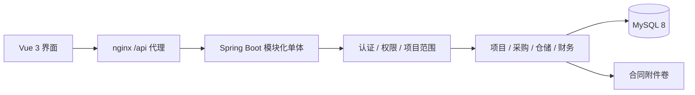

# 架构与模块说明

## 技术决策

采用模块化单体、前后端分离。后端 Java 17 源码目标，JDK 21 构建/运行，Spring Boot 3.5.15、Spring Security、MyBatis-Plus 3.5.17、JdbcTemplate、Flyway；数据库 MySQL 8.0.43，驱动 MariaDB Connector/J 3.5.8。前端 Vue 3、TypeScript、Vite、Element Plus、Pinia、Axios、ECharts。具体锁定版本及传递依赖见机器可读的 `dependencies-*.json`。

默认底座研究基于 RuoYi-Vue-Pro `master-jdk17` 提交 `7c397bbfae3e768b26e3ee962c5aa7064e8d7c96`，revision `2026.09-SNAPSHOT`。完整上游 server reactor 已能构建；未将裁剪描述为上游无法编译。为降低 Demo 部署依赖并隔离建筑领域，本项目裁剪 reactor，只保留完整 common 源码和 BOM，实际复用统一结果与异常。自建精简用户权限、菜单、采购状态机和建筑业务；未移植完整 system/infra/BPM/ERP 或原前端。详见 [研究记录](research.md) 和 `vendor/ruoyi/UPSTREAM.md`。

ERPNext 和 jshERP 仅参考流程，无这两个系统源码或运行时集成。RuoYi 的 MIT 声明、驱动许可和实际依赖清单随源码及镜像保留；清单不替代具体交付包的许可证履约审查。

## 模块与边界

| 目录 | 职责 | 主要数据 |
| --- | --- | --- |
| `platform` | 认证、RBAC、菜单、档案、公司字典、审计、看板、种子、统一异常 | users、roles、sessions、company、suppliers、materials、warehouses、audit_logs |
| `project` | 项目生命周期、项目范围、成本与相关单据聚合 | projects、project_progress |
| `procurement` | 多明细需求、审批、报价、整单授予、订单及取消 | purchase_requests、request_items、approvals、quotes、quote_items、purchase_orders、order_items |
| `inventory` | 收货入库、加权库存、项目领料、流水 | receipts、receipt_items、inventory、issues、stock_movements |
| `finance` | 其他费用、合同、认证附件、应付、付款申请及执行 | costs、contracts、payables、payment_applications、payment_application_records、payments |
| `domain` | 金额、数量精度和通用业务规则 | BigDecimal 校验与计算 |

这些是单一 Maven 应用中的包边界，方便后续抽成独立模块；当前不宣称已拆成多个可独立发布模块。项目是所有采购、合同、领料和成本的重要关联维度。项目 CRUD 实际使用 MyBatis-Plus Mapper，领域聚合和需要明确锁顺序的业务采用 JdbcTemplate。

REST 路径统一 `/api`。成功为 `{code:0,data,msg}`，错误有 HTTP 状态和统一结构。字段使用 snake_case。金额序列化为十进制字符串，前端转数值仅用于图表和格式化，业务金额以服务端计算为准。接口字段和权限见 [API 契约](API-CONTRACT.md)。

## 认证与数据权限

密码 BCrypt，登录生成不透明随机 Bearer token，数据库仅存 token 摘要和到期时间。每次请求检查用户启用状态、会话有效性并加载角色权限；注销使会话失效。前端依据菜单和按钮权限显示功能，后端独立校验 API 权限，不能通过直接请求绕过。

用户当前一个角色。manager 只访问自己负责的项目及其关联单据，只修改自己可操作的申请；禁止申请人自审。其余默认角色按公司范围访问，操作受权限限制。管理员可配置角色权限和菜单、用户、公司与字典。当前 `tenant_id=1` 固定，不具备多租户隔离安全保证；未来必须改造认证上下文、查询、唯一键、附件路径及测试后才可启用多租户。

## 状态机与事务

采购申请：`DRAFT → PENDING → APPROVED / REJECTED`，驳回后可编辑再提交。仅批准申请可以报价并授予；报价覆盖全部申请明细、检查供应商资质及报价有效期，选定时记录理由。同一申请对应一张整单订单，数据库唯一约束和事务防止重复生成。

订单：`OPEN → PARTIAL → COMPLETED`；未收货订单可取消为 `CANCELLED`。每次收货包含验收和库存过账，锁定订单及相关库存，校验可收余量，原子写入验收单、明细、库存、流水和按实际验收金额形成的应付。取消后拒绝收货，超收失败不留部分数据。

项目领料锁库存，校验数量和余额，写入领料单与带项目维度的流水；库存不足拒绝。应付按验收金额确认，付款锁应付、校验余额和唯一参考号。付款申请状态为 `PENDING → APPROVED → PAID`；PENDING 可驳回为 REJECTED，PENDING / APPROVED 可撤回为 CANCELLED。财务提交，负责人独立审批，财务执行；申请人与审批人、审批人与执行人分别禁止相同。驳回、撤回、付款为终态，不修改原单重新提交，需新建申请。操作记录与业务修改、全局审计在同一事务中写入。

申请、审批、撤回和执行统一先锁应付行，再锁申请行；预留金额在锁内按当前记录读取，避免 MySQL REPEATABLE READ 的旧快照。待审批及已批准未付款申请均预留金额；执行时排除本申请、保留其他申请预留。可申请金额受实际验收应付与关联合同金额的较小值约束，减去实付和其他预留；前端展示最低为零。驳回/撤回释放预留，付款同时减少预留与应付余额，不改变项目成本。执行会重新校验余额与合同，若合同变小导致原申请不可执行，可撤回并重报。

直接付款记账需要独立 `finance:record` 权限，默认仅通配管理员拥有，仍遵循预留与合同限额。普通财务不能用直接付款接口绕过申请审批；实际付款没有银行资金操作。

## 金额与成本口径

金额 DECIMAL / BigDecimal、HALF_UP；数量最多 3 位小数，单价 4 位，平均价 6 位，单据金额 2 位。每行金额独立四舍五入，单头合计行金额。库存以仓库和材料为维度，采用简化移动加权平均法。

入库后库存价值 = 原库存价值 + 本次验收金额。

入库后平均价 = 入库后库存价值 ÷ 入库后库存数量（保留 6 位）。

部分领料成本 = 领料数量 × 当前平均价（保留 2 位）；最后一次清空库存时取剩余库存价值，以保持分币守恒，零库存价值归零。

项目实际成本 = 领料减退料成本 + 采购退货计价差额 + 人工费用 + 机械费用 + 分包费用 + 其他费用。

采购申请金额是预算需求，订单金额是采购承诺，入库金额形成库存和应付，付款金额反映现金支出。这些分别展示，不能相加替代实际成本。项目详情同时返回全部口径。预计毛利目前按合同额减累计成本展示，不是完工预测或收入确认模型；已完成产值按合同额乘实际进度估算。

驾驶舱年度合同额按项目 `start_date` 所属自然年度筛选，默认当前年份；并非按合同签订日期汇总。其余指标使用累计或当前口径，采购趋势按订单月份汇总。图表均由数据库汇总接口供给。

## 数据初始化与时间

Flyway V1 建表，V2 对原始演示名称/项目范围作约定修正，V3 仅匹配原始演示记录时修正科技产业园预算与费用以形成超预算场景。V3 采用精确条件保护客户自改记录，不对库存/财务流水改账。V4 增加付款审批字段、操作记录与预留查询索引，并在已有 boss 角色保留 `finance:read` 时补充 `finance:approve`，不覆盖其他权限；原 PENDING 转为需要审批的待办，原 PAID 与金额不改写，不补造旧操作记录。`DemoSeed` 在公司为空时使用事务及 MySQL 命名锁初始化关联演示数据；重复启动跳过。演示种子不提供覆盖重置接口。

数据库会话和 JDBC 使用 UTC，事件 API 返回 ISO 8601 `Z` 时间，前端明确按 Asia/Shanghai 展示；业务 DATE 不转换时区。配置兼容旧连接参数并归一到 UTC，已验证三种 JVM 时区。修复未批量重写旧测试数据中可能已存错的历史时间。

## 构建、部署与持久化

Compose：MySQL 健康后启动后端，前端 nginx 代理后端。后端 Docker 先安装本地 vendor common，再构建应用，运行层 JRE 21 非 root 用户；前端 Node 22 构建。数据库与附件分别为 `mysql-data`、`attachment-data` 卷。镜像保留第三方声明、许可文本及依赖库存；前端也提供静态许可文件。

`start-compose.sh` 使用受限源码清单复制到 ASCII 临时构建目录，保留原 `.env` 和固定 Compose 项目名；防止中文目录 BuildKit 会话问题。本地启动脚本使用隔离缓存、Maven SHA-512 校验和进程/容器身份记录，停止时保留数据库与日志，不接管其他服务。

已通过的真实数据库、并发、界面与重启验证列于 [DEMO](DEMO.md)。生产 TLS、备份恢复、监控、密码生命周期、会话运维和完整安全评估需按客户环境实施。模块、组织权限和接口的扩展应保持项目范围和金额约束，避免绕过领域服务直接改表。

## V5 采购更正与锁顺序

关闭订单保留原金额/数量，单列关闭部分；补采为新草稿并重新审批。净采购订单额扣除关闭与采购退货，原入库和原付款可独立追溯。

项目退料先锁原仓，再锁领料/源流水，以原领料金额按数量分摊，并在最后一次退回时吸收尾差。采购退货先锁订单 → 原仓 → 应付，再锁源明细与库存；检查付款预留采用当前锁定读取。收货与关闭共用订单锁，退款与付款共用应付锁。失败事务回滚已经处理的全部行，不留部分库存变动。

库存流水 RECEIPT、ISSUE_RETURN 为正数量及正价值流入，ISSUE、PURCHASE_RETURN 为负数量及正金额表示流出。采购退货按原入库冲减应付，库存按当前加权价值流出；库存流出减应付冲减的差额以有符号 RETURN_VARIANCE 费用单列并关联退货头，避免改变旧入库或混入领料成本。

退款只冲减净实付，原付款/付款申请维持原始历史。退货后净实付可暂高于净应付，表示待收供应商退款；不能把该状态当作非法付款或负应付未付。每次付款、退款及预留仍由服务端限额校验。部署后 32 项 SQL 检查覆盖这些口径，实际结果见采购升级文档。
